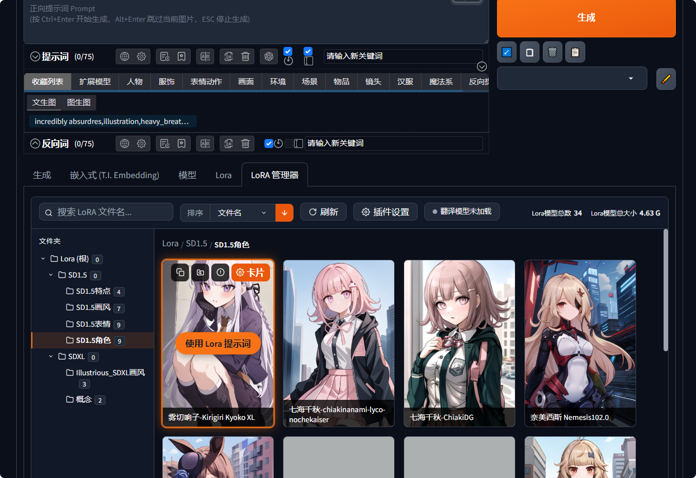
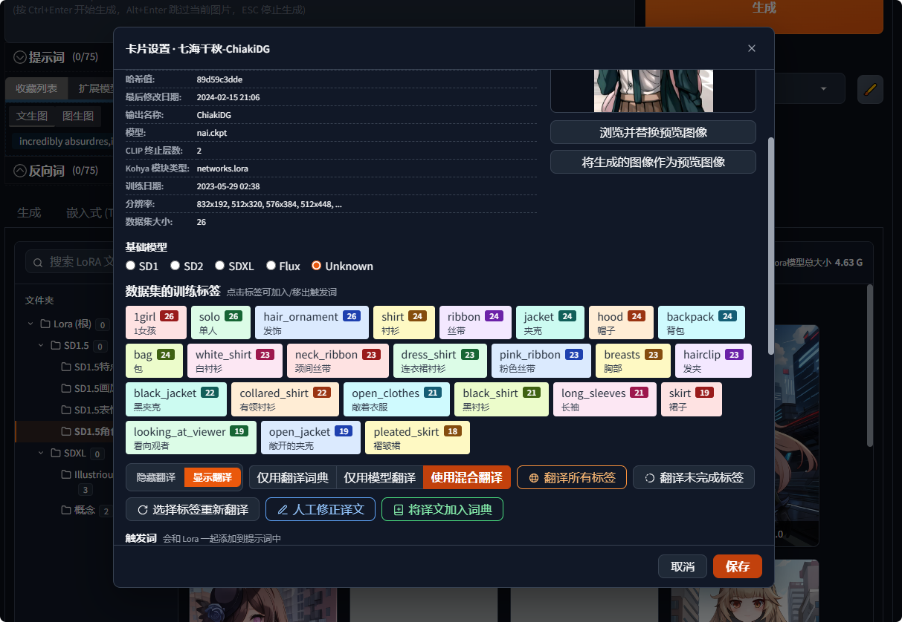
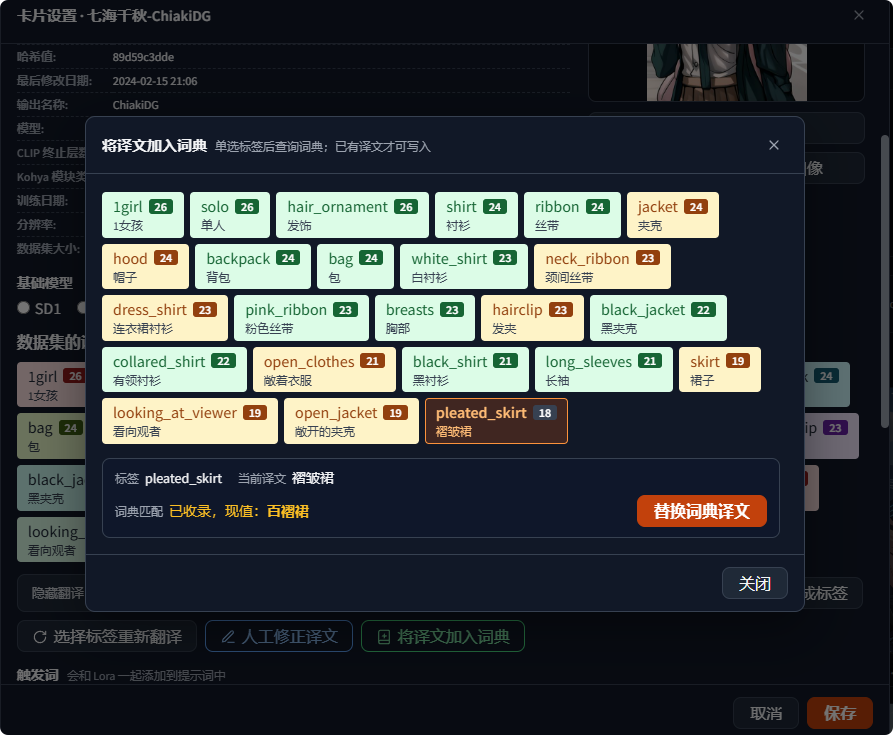
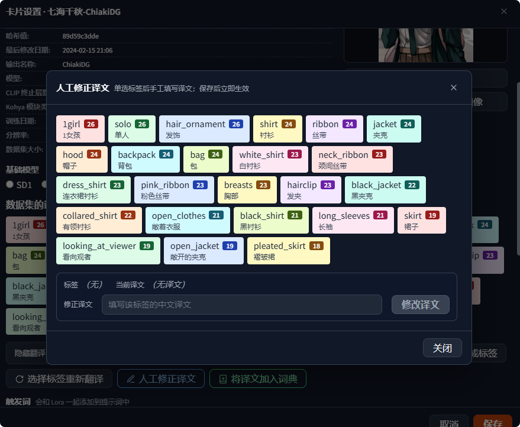

# sd_forge_lora_new

Stable Diffusion WebUI Forge 的 **LoRA 管理器** 插件。以「LoRA 管理器」页面形式注入到 txt2img / img2img 下方的 Extra Networks 区域，提供 **顶部栏 + 左侧文件夹树 + 右侧卡片网格** 的三栏文件管理器式浏览，替代内置 `sd_forge_lora` 的平铺卡片页。

## 界面预览

**LoRA 管理器主界面**：顶部栏（搜索 / 排序 / 刷新 / 插件设置 / 翻译模型状态 / 模型统计）、左侧文件夹树与右侧卡片网格。鼠标悬停卡片即出现「使用 Lora 提示词」按钮，避免误触写入。



**卡片设置**：展示 safetensors 内部元数据（哈希值、模型类型、训练日期、分辨率等）与数据集训练标签（角标数字为出现次数）。可编辑描述、基础模型、触发词、推荐权重、反向提示词与注意事项，并集中提供标签翻译的各类入口。



**将译文加入词典**：单选一个标签即可查询它在翻译词典中的收录情况，确认后把该标签的当前译文写入或替换词典。



**人工修正译文**：单选标签后手工填写或修正其中文译文，保存后立即生效。



## 功能特性

- **三栏式浏览**：顶部栏 + 左侧文件夹树 + 右侧 LoRA 卡片网格
- **文件夹分级导航**：树状菜单、展开状态记忆、文件夹徽标显示模型数量
- **递归搜索**：可切换是否搜索子文件夹
- **多维排序**与使用统计（使用次数 / 最近查看）
- **悬停确认式写入提示词**：`<lora:名字:权重> 触发词`，防误触
- **卡片设置详情页**：safetensors 元数据、训练标签、触发词 / 反向提示词 / 推荐权重、封面上传
- **标签中文翻译**：本地词典 + GGUF 大模型混合翻译，支持翻译模型自动下载
- **界面多语言（i18n）**：内置简体中文 / 繁體中文 / English / 日本語 / 한국어 / Français / Русский 七种语言；语言包放在 `lna_i18n/locales/`，新增语言只需放入一个同结构 JSON，无需改动代码
- **可独立运行**：自带 `lna_lora_engine`，内置 `sd_forge_lora` 被禁用时自动接管 `<lora:>` 解析

## 安装

将本仓库克隆到 WebUI 的 `extensions` 目录下：

```bash
cd <你的 WebUI 根目录>/extensions
git clone https://github.com/qcytkk/sd_forge_lora_new.git
```

然后重启 WebUI。启动后在 txt2img / img2img 页面下方即可看到「LoRA 管理器」页面。

## 版本管理

本仓库使用 **Git 标签（tag）** 标记版本，配合 `main` / `dev` 分支管理迭代。

### 查看与切换版本

```bash
git fetch --tags          # 拉取所有版本标签
git tag -l                # 列出所有版本
git checkout v1.0.0       # 切换到指定版本（回退）
git checkout main         # 回到最新稳定版
```

也可以在 GitHub 仓库的 **Releases** 页面直接下载对应版本的源码压缩包。

### 分支约定

| 分支 | 用途 |
|---|---|
| `main` | 稳定版，发布版本以 tag 形式打在此分支 |
| `dev`  | 开发版，新功能先在此开发，稳定后合并到 `main` |

### 版本号约定

采用语义化版本 `v主版本.次版本.修订号`：

- 修复 Bug → 修订号递增（如 `v1.0.1`）
- 新增功能 → 次版本递增（如 `v1.1.0`）
- 不兼容变更 → 主版本递增（如 `v2.0.0`）

## 可选依赖

- **`llama-cpp-python`**：启用 GGUF 大模型翻译。未安装时插件仍可正常工作，仅使用本地词典翻译；GPU 推理需安装 CUDA 版本。

```bash
pip install llama-cpp-python
```

## 数据与隐私

插件在运行时会生成以下**本地数据**，它们与你的模型库相关，**不随本仓库分发**，且已写入 `.gitignore`：

| 路径 | 说明 |
|---|---|
| `data/stats.json` | 使用统计、翻译相关的全局设置 |
| `data/ui_settings.json` | 界面偏好设置 |
| `data/translations.json` | 模型翻译缓存 |
| `models_json_data/` | 每个 LoRA 的卡片资料（镜像你的 LoRA 目录结构） |
| `__pycache__/` | Python 字节码缓存 |

> `data/en_zh_dictionary.csv` 是通用英中标签词典（静态资源，约 10.8 万条，首行为表头「英文,中文」），随仓库分发。

## 目录结构

```
sd_forge_lora_new/
├── preload.py                # 扩展入口声明
├── scripts/main.py           # 后端逻辑（FastAPI 路由 + 扩展注册）
├── javascript/lora_new.js    # 前端交互
├── style.css                 # 样式
├── lna_lora_engine/          # 自带的 <lora:> 解析引擎
├── lna_i18n/                 # 界面多语言（locales/ 语言包 + 后端实现）
├── docs/images/              # README 截图
├── data/                     # 运行时数据（en_zh_dictionary.csv 为静态英中词典）
└── .gitignore
```

## 致谢与许可

- 英中标签词典由两部分合成：主体为 danbooru 中文标签表（SFW，经去重 / 超长精简 / 语义核查等修正），并与源自 [sd-webui-prompt-all-in-one](https://github.com/Physton/sd-webui-prompt-all-in-one) 的旧版词典合并（重叠项以旧版译文为准）。
- `lna_lora_engine/` 移植自 Forge 内置的 `extensions-builtin/sd_forge_lora`。
- 本项目遵循 **AGPL-3.0** 许可协议，详见 [LICENSE](LICENSE)。
